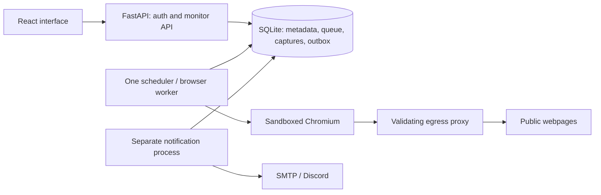

# Trace

**Know what changed. See why it matters.**

Trace monitors public webpages, preserves changed versions and shows the evidence
behind an alert. Built by Prashanth Manokar for the VinnovateIT recruitment assignment.


## Current delivery status

The application runs locally with a React interface, FastAPI API, durable SQLite
queue, Playwright capture, region picker, version comparison and notification
outbox. Public visitors see only explicitly generated demonstration monitors;
owner monitors require authentication, including their screenshots.

**Source-code submission; no hosted service is required or provisioned.** SMTP/Discord
provider delivery requires credentials and an authorized test. The Docker/Linux
isolation configuration must pass its deployment gate before public use.
**Verification:** 48 tests and 3 subtests passed; production frontend build passed; npm audit reported zero known vulnerabilities.
See [the evidence audit](docs/AUDIT.md) and [current status](docs/STATUS.md).

## Features

- Public HTTP(S) monitors, 15–1440 minute intervals, manual checks, pause/resume/delete.
- A separate worker with persistent jobs, leases, retries and per-host spacing.
- Compatible due monitors share a browser render, with individual filters afterward.
- Real page screenshots and normalized text; unchanged checks do not duplicate versions.
- Optional marked-element noise filters, sensitivity and cumulative significance.
- Click a captured page element to watch/ignore it; selectors and match counts can be previewed.
- Version timeline, text additions/removals, side-by-side screenshots and a pixel highlight view.
- Durable SMTP/Discord outbox, event deduplication, delivery history and explicit uncertain state.
- Private owner workspace with read-only public fixture demonstration.


## Quick start

Requirements: Python **3.12**, Node **24**, npm and a supported Playwright machine.
For a fresh clone, run the following from the repository root:

```sh
python3.12 -m venv .venv
.venv/bin/python -m pip install -r requirements.lock
.venv/bin/python -m playwright install chromium
npm ci --prefix frontend
npm run build --prefix frontend
cp .env.example .env
.venv/bin/python scripts/set_password.py
PYTHONPATH=backend:. .venv/bin/python scripts/demo.py
.venv/bin/python scripts/run.py
```

On Linux, Chromium also needs system libraries. Use
`.venv/bin/python -m playwright install --with-deps chromium` during installation,
or the supplied container image. Native local execution is for development; it
is not the production network-isolation boundary.

Open **http://127.0.0.1:8000**. Use that exact address, matching `TRACE_BASE_URL`.
Click **Owner sign in** using the password you entered locally. Password setup
stores an scrypt hash in `.env`; restart the API after changing it.

The runner starts the API, proxy, monitoring worker and notifier. Ctrl-C shuts
these down together. The computer must remain awake for local scheduled checks.
Do not run a second copy on the same ports or data directory.

To recreate only the generated public fixtures:

```sh
PYTHONPATH=backend:. .venv/bin/python scripts/demo.py --reset-demo
```

The three fixture pages are clearly labelled examples. Their screenshots are
rendered in real Chromium; they are not actual scholarships, releases or events.
The fixture transport exists only in the explicit demo/test code. Production
requests cannot turn it on. Generated monitors are paused after capture.

## How to use Trace

1. Sign in and choose **Add monitor**. Use a public page that permits monitoring.
2. The initial capture establishes the baseline. It does not send a change alert.
3. Open **Regions & settings** to select an element in the screenshot or choose
   it from the accessible element list. Add it to watched or ignored regions.
4. Choose **Preview compared text** to inspect exactly what remains and verify
   selector match counts. Save settings; changed filters start a new baseline.
5. Compare saved versions using the history list or the two version selectors.
6. Open **Check log** to distinguish unchanged content from errors and access blocks.

### Noise filters

The presets remove **explicitly marked elements**: `time`/`[data-timestamp]`,
`[data-counter]`, `[data-ad]`/`.advertisement`/`[aria-label="Advertisement"]`,
`[data-rotating-banner]` and `[data-random-token]`. They are opt-in and visible in
preview. For different markup, pick an ignored region yourself. Ordinary numbers,
prices and deadlines are retained. Do not enable timestamp removal when a `time`
element contains the deadline you want to monitor.

The hash is SHA-256 of normalized, visible selected text after exclusions. Unicode
NFC and whitespace normalization are applied. Images alone do not trigger a version.
Sensitivity affects alerts, not version storage. Significant changes are measured
against the last significant text, so small edits can accumulate. A → B → A saves
three chronological versions. Settings revisions are recorded explicitly.

## Notifications

Populate SMTP and/or Discord variables in `.env` directly; do not put secrets in
chat, source files or the browser. Restart the API and notifier, then enable the
channel in **Notifications**. Enabling it authorizes automatic alerts for future
meaningful changes. Each channel starts disabled.

SMTP uses STARTTLS (normally port 587). Discord URLs must use the exact
`https://discord.com/api/webhooks/<id>/<token>` form. Redirects are not followed.
Discord mentions are disabled. The alert contains actual changed-text excerpts
and a comparison link using `TRACE_BASE_URL`.

Events are queued atomically with the version, unique per version/channel. Events
are spaced by at least ten minutes per monitor/channel without discarding queued
changes. Known failures have bounded retries. A timeout or an interrupted send
can mean the provider accepted the message; these become **uncertain**, requiring
recipient inspection before an owner chooses **Retry delivery**. Exactly-once
provider delivery is not guaranteed.

Local transport tests do not establish real inbox/Discord delivery. No external
message was sent during implementation.

## Architecture



React/TypeScript/Vite provides the interaction layer; Python keeps the backend
approachable. SQLite WAL and explicit transactions keep queue claims and version
writes atomic. Screenshots are stored as **SQLite blobs** to keep their lifecycle
atomic with each version, avoiding orphan files. This intentionally revises the
Phase 0 file-storage proposal. The whole app fits on one persistent host.

BeautifulSoup/SoupSieve select from an inert serialized **rendered DOM**, including
visibility pruning and element identities collected by Chromium. They do not
replace browser rendering. The original comparison foundation remains in
`backend/detector/core.py`; its early standalone store is retained for its tests.
The application uses the versioned schema in `backend/traceapp/db.py` and a
separate `trace.sqlite` file. No existing foundation database is overwritten.

Jobs use unique monitor IDs, transactional claims, expiring leases and revision
tokens. Pausing, changing settings or deleting a monitor invalidates pending
results. Startup coalesces missed schedules rather than replaying every missed
interval. One browser worker is enforced with a process lock.

## Security and limits

See [deployment and security boundaries](docs/DEPLOYMENT.md) before hosting.

- Owner writes require a session, same-origin request and CSRF token. Cookies are
  HttpOnly/SameSite=Strict and Secure when the public base URL is HTTPS.
- Public reads cannot access private monitor records or captures.
- The proxy validates all resolved addresses and connects to the selected numeric
  IP, addressing the DNS check/connection race. Private/loopback/link-local/reserved
  destinations, unsafe schemes/ports and URL credentials are rejected.
- Chromium has service workers, WebSockets, downloads, non-GET/HEAD requests and
  unnecessary media/font fetches blocked. Browser environment omits app secrets.
- Fixed 1280px viewport; screenshot height capped at 4000px; 50-second capture limit;
  100 routed requests; 12MB per proxy connection and 32MB aggregate per minute.
- One render at a time; minimum 15-second top-level domain spacing by default;
  proxy connections to a host are spaced at least 250ms; Retry-After is bounded to a day.
- robots.txt is cached for an hour: allow on 404, parse on 200, block on other
  statuses/redirects or verification failure. This conservative policy may reject sites.
- Up to 100 owner/demo monitors through the API, 50 versions per monitor by default,
  200 recent checks per monitor and a 512MB capture payload budget. Undelivered alerts
  may retain both referenced versions beyond the per-monitor count.
- The API rate-limits requests and enforces a 20KB write-body limit.

## Tests

Build the frontend before browser tests:

```sh
npm run build --prefix frontend
.venv/bin/python -m pytest -q
npm audit --prefix frontend
```

Tests cover real Chromium fixture rendering, production proxy/renderer integration,
HTTP/CAPTCHA/robots handling, private redirects, DNS answers, queue leases/retries,
shared rendering with request counts, CRUD/auth/CSRF, screenshots, noise filtering,
version history, outbox behavior and owner UI interactions at desktop/mobile widths.
The UI test temporarily uses port 8011 and its own database/password.

See `docs/AUDIT.md` for the current observed counts and remaining verification.

## Storage, backup and recovery

Default storage: ignored `data/trace.sqlite` plus SQLite WAL files. `TRACE_DATA`
can change the directory. Never put it in Git or an ephemeral hosting filesystem.
Schema version 1 initializes idempotently, followed by the transactional version 2 outbox comparison migration; unsupported versions fail explicitly.
Future schema changes require numbered migrations and backup first.

```sh
PYTHONPATH=backend .venv/bin/python scripts/backup.py /safe/private/path/trace-backup.sqlite
```

The backup API produces a consistent snapshot while the app is running. Backups
include private captures and sessions. To restore: stop all Trace processes, move
the current data directory to a private backup location, create a fresh data
directory, copy the backup as `trace.sqlite`, delete restored sessions with SQLite,
and restart. Never copy a live `.sqlite` file alone while ignoring its WAL.

Deletion cascades through versions, checks, jobs and outbox. SQLite can reuse freed
pages; file size may not shrink until a maintenance `VACUUM` while the app is stopped.

## Deployment and submission

Follow [the single-host deployment guide](docs/DEPLOYMENT.md). Do not expose the
native development runner or proxy to the internet. The Compose configuration
separates the browser network from the API and the public network on the same host.

The recruitment submission is this public source repository. Reviewers can run it
locally using the quick start above; no hosting account or paid service is needed.
Linux isolation verification is required only before a future public deployment.
Real notification delivery requires privately configured provider credentials.

- [Five-minute demo and interview notes](docs/INTERVIEW.md)
- [Requirement audit](docs/AUDIT.md)
- [Implementation status](docs/STATUS.md)

## Known limitations and next improvements

- No image-only change trigger, OCR, login monitoring or CAPTCHA bypass.
- Picker supports top-level light DOM only. Cross-origin frames and shadow roots
  are unsupported; generated selectors can break when page structure changes.
- Captures cover the first 4000 vertical pixels; visible text can include content
  farther down. Choose a supported region near the top for matching visual evidence.
- Pixel highlights can include layout shifts; they are not semantic visual analysis.
- CAPTCHA detection is heuristic. HTTP-200 outage pages without known challenge
  phrases can still look like content; no universal classifier is claimed.
- Robots restrictions, resource budgets and site bot protection can prevent capture.
- Single owner, single worker, single persistent host. The 200-subscription test is
  a controlled fetch-sharing test, not a production load certification.
- Native Mac operation lacks the network isolation of the intended Linux deployment.
- Daily digests, AI, RSS, browser extensions and charts are intentionally absent.

Future priorities: verified Linux deployment, broader selector robustness, optional
visual-only triggers and richer provider delivery handling after the core submission.
