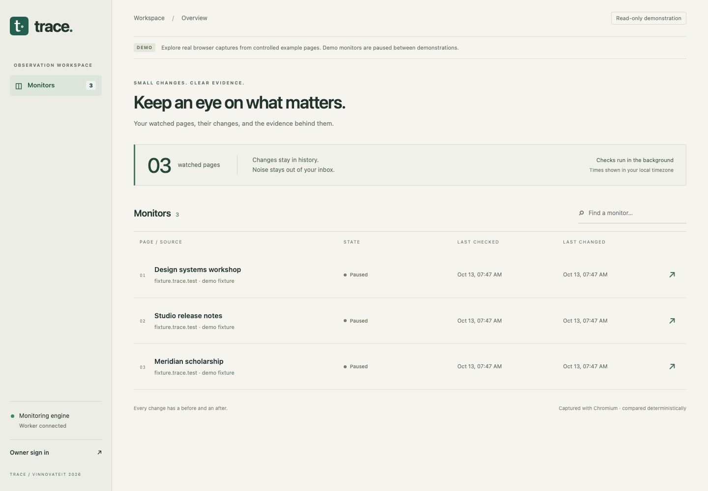
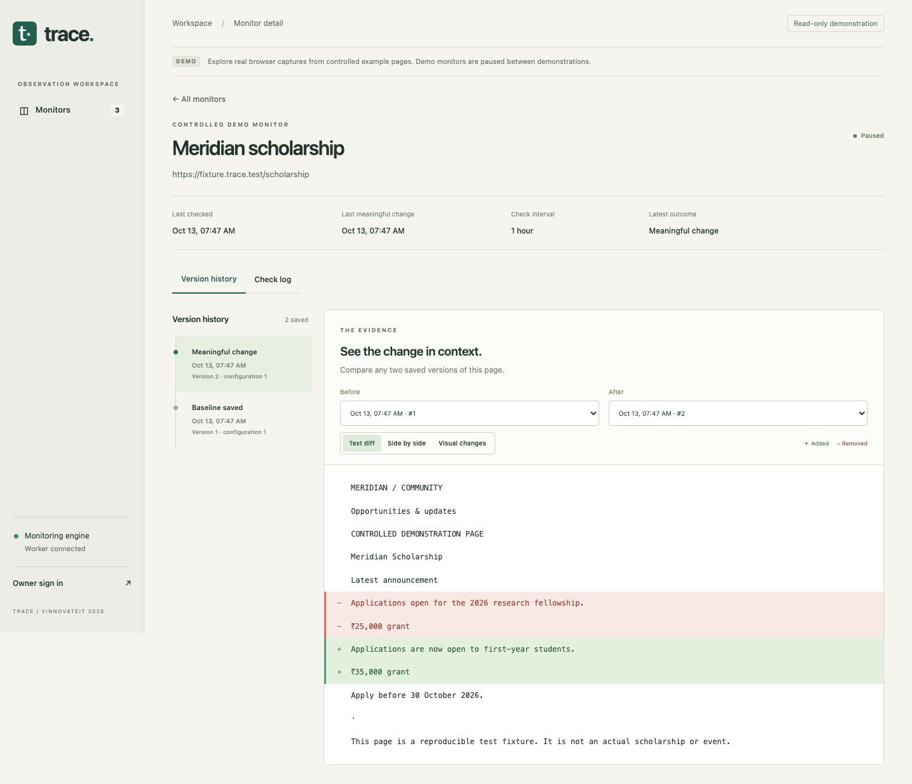

# Trace

A website change detector for the VinnovateIT web development assignment.
Add a public webpage, choose how often to check it, and compare saved versions when
its text changes. You can watch one part of a page and ignore sections such as ads
or counters.



## What it does

- Checks pages every 15 minutes to 24 hours using Chromium.
- Saves text and a screenshot when the compared text changes.
- Lets you select watched and ignored elements from a screenshot.
- Shows a version timeline, text differences, side-by-side screenshots and highlighted image differences.
- Queues email and Discord alerts for changes that pass your sensitivity setting.
- Records failed and blocked checks separately from content changes.

There is one owner account. Visitors can view the included examples, but cannot
access the owner's monitors. The examples use fictional pages rendered in Chromium;
they are labelled as examples and paused after their captures are generated.

## Run locally

You need **Python 3.12**, **Node.js 24** and npm. Clone this repository and run:

```sh
git clone https://github.com/prashumanocg/trace-website-change-detector.git
cd trace-website-change-detector
python3.12 -m venv .venv
.venv/bin/python -m pip install -r requirements.lock
.venv/bin/python -m playwright install chromium
npm ci --prefix frontend
npm run build --prefix frontend
cp .env.example .env
.venv/bin/python scripts/set_password.py
PYTHONPATH=backend:. .venv/bin/python scripts/demo.py
.venv/bin/python scripts/run.py
```

On Linux, use `playwright install --with-deps chromium` in the installation step
to install the browser's system dependencies too. These commands use a macOS/Linux shell.

Open **http://127.0.0.1:8000** and choose **Owner sign in**. Use the password you
entered during setup. The password hash stays in the ignored `.env` file.

Keep the runner open and the computer awake for scheduled checks. Ctrl-C stops it.
After changing `.env`, restart the runner. This is a local app; no hosting account
or paid service is needed to review the submission.

## Try it

1. Explore an example monitor and compare its two versions.
2. Sign in and add a public URL with a name and check interval.
3. After the first capture, open **Regions & settings**. Select an element to watch
   or ignore, then preview the text before saving.
4. Use **Check log** to see whether a check succeeded, failed or was blocked.

Changing the selection or filters starts a new baseline. Some websites block
browser automation or disallow checks through robots.txt.



## How it works

React and TypeScript handle the interface. FastAPI handles requests, owner sessions
and monitor settings. SQLite stores monitors, jobs, text, screenshots and pending
notifications. A separate worker checks for due jobs and opens pages in Playwright.

The worker extracts visible text, applies the selected filters, normalizes whitespace
and hashes the result. If the hash matches the previous version, no new version is
saved. Sensitivity decides whether a saved change should also produce an alert.
Small edits are compared against the last significant version so they can accumulate.

Checks due for the same URL can share one browser capture. Failed jobs have bounded
retries, and requests to the same host are spaced apart. A validating proxy rejects
private network destinations. The local runner is for development; see the deployment
notes before exposing it to the internet.

Noise presets target marked elements such as `time`, `[data-counter]`, `[data-ad]`,
`[data-rotating-banner]` and `[data-random-token]`. They do not automatically recognise
every ad or timestamp. Use ignored regions for other markup. Prices and ordinary
numbers are retained; avoid filtering a `time` element containing a deadline you need.

## Notifications

Email and Discord are optional. Set the relevant values from `.env.example` in your
local `.env`, restart, and enable the channel in **Notifications**. SMTP uses STARTTLS.
Never commit passwords or webhook URLs.

Alerts are saved with their change event and sent by a separate process. If a send
has an unknown outcome, it is marked **uncertain** rather than retried automatically,
because the provider may already have accepted it. Check the recipient before retrying.
Real inbox and Discord delivery have not been tested; the transport tests use local adapters.

## Tests

```sh
npm run build --prefix frontend
.venv/bin/python -m pytest -q
npm audit --prefix frontend
```

The last local run passed **48 tests and 3 subtests**. Tests cover filtering, version
storage, the job queue, shared captures, access controls, browser rendering and the
main interface flows. The production frontend build also passed.
See [testing notes](docs/AUDIT.md) for the checks and their limits.

## Limits

- Text changes trigger versions; image-only changes do not.
- Screenshots stop at 4000 pixels. The picker supports the main page's regular DOM,
  not shadow roots or cross-origin frames.
- HTTP errors and recognised CAPTCHA pages are rejected. An unfamiliar error page
  returning HTTP 200 can still be mistaken for changed content.
- Image highlights include layout shifts as well as changed content.
- This is a single-owner, single-worker app. Shared-fetch tests are not a multi-user load test.
- Daily digests, RSS, charts and AI summaries are not included.
- Docker configuration is included, but has not been tested on a running Linux host.

## Project files

- `frontend/src/` — interface and styles
- `backend/traceapp/` — API, browser capture, queue, notifications and database
- `backend/detector/` — text comparison functions and the original standalone store
- `tests/` and `backend/tests/` — browser, API and unit tests
- `scripts/` — local runner, example data, password setup and backups

Captures and sessions are stored in ignored `data/trace.sqlite`. To create a consistent backup:

```sh
PYTHONPATH=backend .venv/bin/python scripts/backup.py /safe/private/path/trace-backup.sqlite
```

Backups contain private data too. Keep them out of Git.

[Optional deployment and recovery](docs/DEPLOYMENT.md) · [Project status](docs/STATUS.md)
