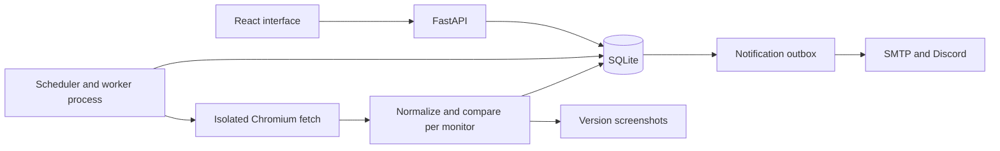

# Trace — VinnovateIT Website Change Detector

> Historical plan. Public deployment is now the target. Current behavior and evidence are in README.md, STATUS.md and AUDIT.md.

Decision record, 12 October 2026. Status: architecture selected as a practical default;
implementation is starting. This document describes intended behavior, not completed features.

## Assignment authority and scope

Use the supplied screenshot when the pasted master prompt differs:

- Intervals: **15 minutes to 24 hours**, not 5 minutes.
- Render public pages using Playwright/Puppeteer; do not store monitored-site credentials.
- Scheduler AND job queue, including timeouts and retries.
- Capture text and screenshot on successful checks; retain a new version only when
  its content hash changes. Record check outcomes even when no version is created.
- Noise filters and sensitivity; visual watch/ignore selector picker.
- Text diff, highlighted screenshot diff, arbitrary two-version comparison.
- Email plus Discord or Telegram alerts with summary and comparison link; deduplication.
- Timeline and last checked/changed/status dashboard.
- Daily digest is optional. Screenshot bonuses also include keyword alerts, numeric
  charts, AI summaries, browser extension, and per-page RSS. Defer all bonuses.
- Submission is a public GitHub repository. A hosted app is desirable, not stated
  as mandatory in the supplied screenshot.
- Deadline supplied by Prashanth: **15 October 2026, 23:59 IST**. Not independently
  verified; the recruitment URL could not be read by the web tool.

Default: a single-owner, local-first app with a reproducible demo. No payment,
cloud provisioning, GitHub publication, or external message sending has occurred.
Do not claim production multi-user support from a shared-fetch test.

## Product

Working name: **Trace**. Promise: “See what changed. Keep the context.”

Three primary views: monitors dashboard; monitor detail with timeline/settings;
comparison with text, screenshot, and highlighted-difference modes. Add-monitor
is a focused form. Notification settings are global initially.

Use warm white, dark ink, restrained teal accents, readable system typography,
and explicit text labels for statuses. Changes are the primary content, not charts
of invented statistics. Keyboard focus, labelled inputs, accessible contrast,
mobile stacking, empty/error/loading states, and reduced motion are acceptance criteria.

## Architecture and why

| Layer | Choice | Reason |
|---|---|---|
| Interface | React + TypeScript + Vite; Tailwind for styling | Reusable interactive comparison UI and typed API data |
| HTTP API | Python + FastAPI + Pydantic | Fits existing Python knowledge; validates inputs |
| Persistence | SQLite, WAL, migrations | One machine, durable storage, no DB service required |
| Worker | Separate Python process; SQLite jobs with leases | Restarts do not erase pending work; API stays responsive |
| Rendering | Playwright Chromium, fresh context per fetch | Real JavaScript rendering and matching screenshots |
| Extraction | Rendered DOM text + element bounds | The picker and text use the same rendered document |
| Comparison | SHA-256, deterministic text diff, Pillow image diff | Explainable behavior without AI/API costs |
| Files | Local data directory outside source control | Screenshot persistence and predictable ownership |
| Alerts | SMTP + Discord webhook, environment secrets | Covers both required channel types |

Use a supported Python 3.12+ environment for the application. The first pure-Python
foundation also runs on this Mac's detected Python 3.9.6. Node 24.21.0, npm and Git
are present. No full application dependencies have been installed yet.

Do not add Redis/Celery, PostgreSQL, a separate scheduler framework, or BeautifulSoup
until needed. DOM extraction avoids parsing a second interpretation of the page.
The small durable queue is deliberately limited to one worker process initially;
its claiming, restart recovery and deduplication must be tested, not hand-waved.
PostgreSQL becomes appropriate if we later run multiple server machines.

Planned records: fetch_targets, monitors, check_runs, snapshots, jobs,
notification_outbox, and domain_limits. A monitor refers to a fetch target and
has its own selectors, normalization settings, sensitivity and baseline.

## Core behavior and difficult decisions

1. **Outage/CAPTCHA:** classify HTTP failures, timeouts, known challenge signals,
   and missing watched regions before comparing content. Preserve the last good
   baseline; update last_checked and failure status, never last_changed. CAPTCHA
   detection is heuristic and must have documented false-positive/negative limits.
   Do not retry access blocks aggressively or attempt bypasses.
2. **Shared fetches:** coalesce concurrently due jobs using exact normalized URL
   plus rendering profile (viewport, locale, wait policy). Preserve query semantics;
   do not sort or drop arbitrary query parameters. One render supplies a bounded
   DOM/element/text representation and screenshot for compatible subscribers.
   Apply selectors and sensitivity separately. Different due times or rendering
   profiles need not share a fetch. Prove this using 200 monitor subscriptions
   and a fixture request counter; it is not a 200-user production load claim.
3. **Noise:** first normalize whitespace and explicitly selected exclusions.
   Timestamp filtering is opt-in. Counters, random IDs and banners are preferably
   excluded by selectors; never strip every number and hide prices or deadlines.
   Offer preview of filtered text. Detect unstable pages using repeated samples,
   warn the user, and recommend narrowing the region. Do not silently learn away
   every fluctuating element.
4. **Hashes versus alerts:** a hash answers “is this normalized content different?”;
   sensitivity answers “should we alert?”. Store changed content even below the
   alert threshold; compare significance with the last significant baseline so
   gradual small changes accumulate. Initial baseline produces no change alert.
   Filtering/selector changes start a new configuration baseline.
5. **Screenshots:** use a fixed viewport, disable animations, bound page height,
   and record capture dimensions. Mask ignored areas for the highlighted diff;
   retain context for side-by-side views. Padding and layout shifts are explicit
   limitations of pixel differences. In the initial text-based detector, a purely
   visual change is not a version trigger: document this rather than implying
   comprehensive image-only monitoring.
6. **Visual picker:** show the actual screenshot with element rectangles gathered
   in the same render. Clicking a rectangle selects a real generated CSS selector;
   show match count and highlighted result. Validate uniqueness/stability on the
   captured DOM and on future runs. Restrict v1 to top-level light DOM; cross-origin
   iframe and shadow DOM selection need explicit unsupported states. Never iframe
   arbitrary remote HTML into the app or claim a freehand rectangle is a CSS picker.
7. **Scheduling:** persisted due times, unique pending jobs, atomic claims, lease
   expiry after crashes, bounded attempts, exponential backoff with jitter, and
   coalesced missed checks after sleep. Initially one render at a time. Per-host
   spacing applies to manual, scheduled and preview fetches. Honor Retry-After,
   cache and respect robots rules, and conservatively suspend on repeated blocks.
   Keep limits configurable; subresource traffic also needs a bounded budget.
8. **Alerts:** transactional outbox with a unique monitor/event/channel key and
   delivery state. A cooldown coalesces events without discarding version history.
   Use bounded retries. Exact-once SMTP/Discord delivery cannot be guaranteed if a
   provider accepts a message and the acknowledgement is lost; document ambiguity.
   Store last alert separately from last meaningful change. Local comparison links
   open on the machine running the demo; remote access needs hosting.

## Security is a real implementation risk

Validating the initial URL alone is insufficient. Reject credentials in URLs,
non-HTTP(S), unsafe ports, private/loopback/link-local/reserved IPv4 and IPv6,
and mixed public/private DNS answers. Apply policy to redirects and every network
request, including frames and assets. Block service workers and unsupported network
paths; bound redirects, bytes, execution time, image height, requests and concurrency.

**DNS rebinding:** checking DNS and then letting Chromium resolve independently
leaves a race. The intended boundary is a validating outbound proxy that connects
to an approved resolved IP, with browser direct egress denied in an isolated worker.
This isolation may justify a container even though the application architecture
does not require Docker. Do not describe a route callback alone as SSRF-proof.
Before arbitrary public URL fetching is enabled, verify the transport boundary;
use injected fixture results for early tests rather than weakening production URL
policy with a general allow-private flag.

Local APIs also need strict Host/Origin handling, session authorization for writes,
and CSRF protection. A malicious website can target localhost. Use no permissive
CORS. Escape remote text in the frontend; never render captured HTML as trusted app
HTML. Redact query tokens and notification credentials from logs. Retention and
deletion must clean up screenshots without deleting files still in use.

## Deployment

Local-first is suitable for the submission: documented setup, committed source,
controlled fixtures, and a recorded or live demonstration. The Mac must be awake
and the worker running for scheduled checks. Public repository does not mean a
publicly writable monitoring service.

After correctness: one paid Linux host with persistent disk, TLS, authenticated
single-owner interface, worker supervision and enforced network isolation is the
simplest hosted shape. No exact price is assumed. Static hosting can serve the
React bundle but cannot by itself host this persistent Python/Chromium worker.
Render's free web services have ephemeral storage and spin down; persistent disks
require a paid eligible service. Do not deploy SQLite + screenshots to ephemeral
storage and call it durable. Splitting a disk-backed DB across separate hosting
services also requires redesign because a disk is not shared storage.

## Effort and deadline plan

Estimate, not a promise: 25–40 focused development/debugging hours for a strong
local submission with AI assistance, plus 3–5 hours for Prashanth to verify and
rehearse. Public multi-user hardening adds days. With other tracks competing for
time, completing every requirement by the supplied deadline is ambitious.

| Time (IST) | Milestone | Exit evidence |
|---|---|---|
| Oct 12 evening | Phase 0 + initial core | Decisions saved; core unit tests |
| Oct 13 | Phases 1–2 | Browser → DB → scheduled retry; failure preserves baseline |
| Oct 14 | Phases 3–4 | Integrated UI, picker, comparisons; email + Discord testing |
| Oct 15 before 18:00 | Phase 5 | Clean install, reproducible demo, requirement audit |
| Oct 15 evening | Submission buffer | README, screenshots, interview rehearsal, public repo verification |

Cut bonuses first. Then defer hosted deployment and multi-user accounts. If picker,
safe network isolation, or delivery verification remains incomplete, disclose it;
do not reclassify mandatory features as optional to claim success.

## Prioritized acceptance checklist

- [x] Audit screenshot and resolve conflicting pasted wording.
- [x] Inspect existing workspace and select local-first architecture.
- [ ] P0: DB migrations, monitor CRUD and validated 15–1440 minute intervals.
- [ ] P0: guarded browser fetch, extraction, actual screenshots, baseline and hash.
- [ ] P0: durable jobs, schedule, retries, restart recovery and failure states.
- [ ] P0: dashboard using actual API data; pause/resume/delete/manual check.
- [ ] P1: version timeline and arbitrary two-version text/screenshot comparison.
- [ ] P1: highlighted screenshot differences and accessible diff legend.
- [ ] P1: noise preview, sensitivity and honest unstable-page behavior.
- [ ] P1: genuine screenshot/DOM CSS selector picker, watch and ignore.
- [ ] P1: SMTP + Discord outbox, retries, deduplication and tested real delivery.
- [ ] P1: shared fetch, domain limits, robots policy and resource limits.
- [ ] P2: keyboard/mobile QA, meaningful integration/security tests.
- [ ] P2: README, .env.example, screenshots, install/deploy guide, limitations.
- [ ] P2: interview notes and clean-machine setup rehearsal.
- [ ] P2: requirement audit using four states and evidence; identify weakest three.
- [ ] Submission: review secrets, get authorization to publish, verify public GitHub URL.

Controlled fixtures: unchanged, meaningful edit, timestamp-only edit, ad rotation,
500 response, CAPTCHA-like response, random content, 200 compatible subscriptions,
missing selector, redirect to private IP, DNS change, failed/ambiguous notification,
and worker death during a leased job. Test-only transports must never be enabled
by normal user input or production environment defaults.

## Installation and user involvement

Next application setup: project-local Python environment with Python 3.12+, locked
FastAPI/Playwright/testing dependencies, Playwright Chromium, frontend dependencies,
and an ignored data directory. No global Python replacement is required.
Later, configure SMTP sender and a Discord test webhook directly in local secrets;
do not paste credentials in chat. Request permission for an actual test delivery.
GitHub publishing requires authorized access; no repository URL is invented.

Use Codex for implementation and code review because its developer views fit this
work. ChatGPT Work can also execute code; use whichever surface helps, keeping one
source tree. Work is useful for planning/interview materials; it is not a separate
required development environment.

## Sources checked

- Assignment: supplied screenshot; pasted master prompt for additional goals.
- https://join.vinnovateit.com/quiz/tech/web-development/1 (not accessible through web tool)
- https://learn.chatgpt.com/docs/use-chatgpt
- https://playwright.dev/python/docs/network
- https://cheatsheetseries.owasp.org/cheatsheets/Server_Side_Request_Forgery_Prevention_Cheat_Sheet.html
- https://render.com/docs/free
- https://render.com/docs/disks

These sources inform decisions, not implementation evidence.
